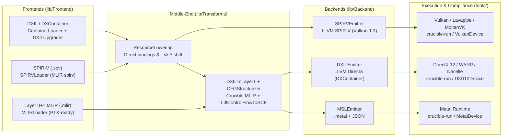

<div align="center">

# Crucible

**An open-source multi-frontend, multi-backend shader compiler for DXIL, SPIR-V, and Metal Shading Language.**

[](https://github.com/farzonl/crucible/actions/workflows/ci.yml)
[](https://github.com/farzonl/crucible/actions/workflows/compliance.yml)
[](https://github.com/farzonl/crucible/actions/workflows/macos-benchmark.yml)
[](https://farzonl.github.io/crucible/?track=dxil-to-metal)
[](https://farzonl.github.io/crucible/?track=dxil-to-spirv)
[](https://farzonl.github.io/crucible/?track=spirv-to-metal)
[](https://farzonl.github.io/crucible/?track=spirv-to-dxil)
[](#building)
[](LICENSE)

[**Compliance Dashboard**](https://farzonl.github.io/crucible/) · [**DXIL → Metal**](https://farzonl.github.io/crucible/?track=dxil-to-metal) · [**DXIL → SPIR-V**](https://farzonl.github.io/crucible/?track=dxil-to-spirv) · [**SPIR-V → Metal**](https://farzonl.github.io/crucible/?track=spirv-to-metal) · [**SPIR-V → DXIL**](https://farzonl.github.io/crucible/?track=spirv-to-dxil) · [**Vulkan CTS**](https://farzonl.github.io/crucible/vulkan-cts.html) · [**Benchmarks**](https://farzonl.github.io/crucible/bench.html)

</div>

---

## Overview

**Crucible** (`cruciblec`) translates shader binaries across DirectX, Vulkan, and Metal using upstream **LLVM 24** and **MLIR**—no custom binary parsers, no closed-source `.air` bitcode hacks, and no heavyweight argument-buffer overhead.

- **Metal backend (`--target=msl`)**: Emits clean, human-readable **Metal Shading Language** with direct `[[buffer(n)]]` bindings and JSON reflection, compiled via Apple's native `xcrun metal` / `metallib` toolchain.
- **Vulkan SPIR-V backend (`--target=spirv`)**: Lowers shaders to **Vulkan 1.3 SPIR-V** via LLVM's SPIR-V target (`spirv1.6-unknown-vulkan1.3-*`), supporting compute, graphics, textures/samplers, bindless heaps, inline `RayQuery`, and DXC-compatible `--vk-*-shift` register shifts.
- **DirectX DXIL backend (`--target=dxil`)**: Lowers unified Crucible MLIR to **DXIL / DXContainer** binaries (or `--dxil-asm` IR) via LLVM 24's DirectX target (`dxil-pc-shadermodel6.*-*`), runnable on Windows D3D12 (hardware adapters and WARP) as well as [Nacelle](https://github.com/farzonl/Nacelle) on macOS/Linux.
- **Multi-frontend ingestion**: Auto-detects **DXIL** (`.dxil` DXContainer or bare LLVM 3.7 bitcode), **SPIR-V** (`.spv`, lowered via MLIR's `spirv` dialect), and standalone **Layer 0+1 MLIR** (`.mlir`, PTX-ready `func` + `scf` + `llvm` + `gpu` + `math`).

### Supported Translation Paths

| Frontend | Backend | Capabilities | Execution / CI Track |
| :--- | :--- | :--- | :--- |
| **DXIL** (`.dxil`) | **Metal MSL** (`--target=msl`) | Compute, Graphics, Mesh, Wave/Quad, Atomics, Bindless, RT | macOS Apple Silicon (`dxil-to-metal`) |
| **DXIL** (`.dxil`) | **Vulkan SPIR-V** (`--target=spirv`) | Compute, Graphics, Textures, Bindless, Inline RT | Linux Lavapipe & macOS MoltenVK (`dxil-to-spirv`) |
| **SPIR-V** (`.spv`) | **Metal MSL** (`--target=msl`) | Compute, Graphics, Textures/Samplers, Wave/Subgroup, CTS | macOS Apple Silicon (`spirv-to-metal`, `vulkan-cts-macos`) |
| **SPIR-V** (`.spv`) | **DirectX DXIL** (`--target=dxil`) | Compute, CBV/SRV/UAV, Groupshared, Wave Ops, Control Flow | Windows WARP (`spirv-to-dxil`) & macOS/Linux Nacelle |
| **Layer 0+1 MLIR** (`.mlir`) | **Metal MSL** (`--target=msl`) | `addrspace(1)` pointer kernels, `gpu.*`, `math.*`, `scf.*` | FileCheck (`mlir_layer01_ptx_ready`) |

---

## Architecture



---

## Compliance & Benchmarks

- **Multi-Track `llvm/offload-test-suite`**: `tools/crucible-offload` builds upstream `offloader` and `api-query` against Crucible's unified runtime (`MetalDevice`, `VulkanDevice`, and `D3D12Device`), selected via `CRUCIBLE_OFFLOAD_RUNTIME=metal|vulkan|d3d12|warp`. Live per-commit pass rates are published on the [**Compliance Dashboard**](https://farzonl.github.io/crucible/).
- **Vulkan CTS (macOS)**: The `vulkan-cts-macos` job runs a pinned 256-case compute sample of `VK-GL-CTS 1.4.7.1` through a fail-closed MoltenVK hook that replaces shader compilation with `cruciblec` (no fallback to SPIRV-Cross), compared side-by-side against a native reference run on the [**Vulkan CTS Dashboard**](https://farzonl.github.io/crucible/vulkan-cts.html).
- **Apple Silicon Benchmarks**: `crucible-run --bench-json` compares GPU-timestamped compute dispatch times against `metal-shaderconverter` on identical `dxc` DXIL (tracked on the [**Benchmark Dashboard**](https://farzonl.github.io/crucible/bench.html)):

| Workload | Crucible (ms) | `metal-shaderconverter` (ms) |
| :--- | ---: | ---: |
| **Streaming FMA** (memory-bound) | 1.59 | 1.59 |
| **Mandelbrot Loop** (ALU-bound) | 1.54 | **1.16** |
| **Groupshared Reduction** (barrier-bound) | **1.26** | 1.64 |
| **Wave Prefix Ops** (SIMD-bound) | 1.55 | 1.54 |

---

## Building

Requirements: **CMake ≥ 3.24**, **Ninja**, **LLVM + MLIR 24** (`third_party/llvm-project` built with `-DLLVM_TARGETS_TO_BUILD="SPIRV;DirectX"`), **`dxc`**, and **`lit`**. Optional: **Vulkan SDK** / MoltenVK / Lavapipe, **Xcode CLT** (macOS), **MSVC + Windows SDK + `dxil.dll`** (Windows), or **[Nacelle](https://github.com/farzonl/Nacelle)** (D3D12 software runtime on macOS/Linux).

```sh
git submodule update --init --depth 1 third_party/spirv-headers third_party/DirectX-Headers

cmake -S . -B build -G Ninja -DCMAKE_BUILD_TYPE=Release
ninja -C build

# Unit / FileCheck / E2E tests
ninja -C build check-crucible

# llvm/offload-test-suite compliance tracks (requires third_party/offload-test-suite)
ninja -C build check-crucible-offload-dx-to-metal  # DXIL -> MSL -> Metal (macOS)
ninja -C build check-crucible-offload-dx-to-vk     # DXIL -> SPIR-V -> Vulkan (Linux/macOS)
ninja -C build check-crucible-offload-vk-to-metal  # SPIR-V -> MSL -> Metal (macOS)
ninja -C build check-crucible-offload-vk-to-dx     # SPIR-V -> DXIL -> WARP (Windows) or Nacelle
```

Useful CMake flags: `-DLLVM_DIR=...`, `-DMLIR_DIR=...`, `-DDXC_EXECUTABLE=...`, `-DLLVM_EXTERNAL_LIT=...`, `-DCRUCIBLE_NACELLE_DIR=...`, `-DCRUCIBLE_OFFLOAD_SUITE_DIR=...`.

---

## Usage & Tools

```sh
# DXIL -> Metal MSL + reflection + .metallib
cruciblec shader.dxil -o out.metal --reflect out.json --metallib out.metallib

# DXIL -> Vulkan 1.3 SPIR-V (binary or --spv-asm text)
cruciblec shader.dxil --target=spirv -o out.spv --reflect out.json
cruciblec shader.dxil --target=spirv --spv-asm --vk-u-shift=10 -o out.spvasm

# SPIR-V -> DirectX DXIL (DXContainer binary or --dxil-asm IR)
cruciblec shader.spv --target=dxil -o out.dxil
cruciblec shader.spv --target=dxil --dxil-asm -o out.ll

# SPIR-V / Layer 0+1 MLIR -> Metal MSL
cruciblec shader.spv -o out.metal --reflect out.json
cruciblec kernel.mlir -o out.metal --dump-mlir

# Run GPU E2E dispatches directly
crucible-run --backend metal  --lib out.metallib --entry main0 --threads 64,1,1 --groups 1,1,1 --buffer 0:f32:64:iota
crucible-run --backend vulkan --spv out.spv      --entry main  --groups 1,1,1 --buffer 0:f32:64:iota
crucible-run --backend d3d12  --dxil out.dxil                  --groups 1,1,1 --buffer 0:f32:64:iota
```

| Tool | Purpose |
| :--- | :--- |
| `tools/cruciblec` | Multi-frontend, multi-backend compiler CLI (`--target=msl\|spirv\|dxil`, `--reflect`, `--metallib`, `--spv-asm`, `--dxil-asm`, `--vk-*-shift`, `--dump-mlir`). |
| `tools/crucible-run` | Multi-backend compute runner (`--backend metal\|vulkan\|d3d12`) and Metal GPU-timestamp benchmark harness (`--bench-json`). |
| `tools/crucible-offload` | Multi-runtime `llvm/offload-test-suite` device provider (`MetalDevice`, `VulkanDevice`, `D3D12Device` via `CRUCIBLE_OFFLOAD_RUNTIME=metal\|vulkan\|d3d12\|warp`). |

---

## Built On & License

Crucible builds on **[LLVM + MLIR](https://llvm.org)**, **[DirectX-Headers](https://github.com/microsoft/DirectX-Headers)**, **[DirectXShaderCompiler](https://github.com/microsoft/DirectXShaderCompiler)**, **[SPIRV-Tools](https://github.com/KhronosGroup/SPIRV-Tools)**, and **[Nacelle](https://github.com/farzonl/Nacelle)**.

Licensed under **Apache-2.0 WITH LLVM-exception**.
