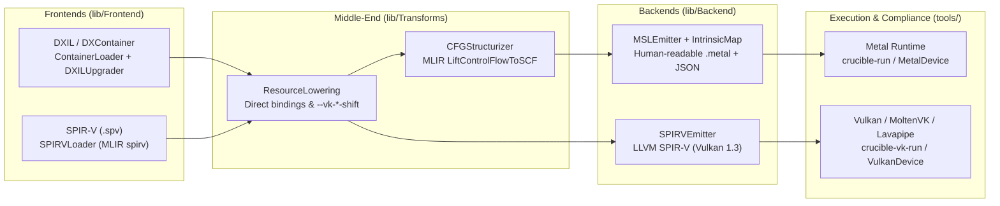

<div align="center">

# Crucible

**An open-source multi-frontend, multi-backend shader compiler for DXIL, SPIR-V, and Metal Shading Language.**

[](https://github.com/farzonl/crucible/actions/workflows/ci.yml)
[](https://github.com/farzonl/crucible/actions/workflows/compliance.yml)
[](https://github.com/farzonl/crucible/actions/workflows/macos-benchmark.yml)
[](https://farzonl.github.io/crucible/?track=dxil-to-metal)
[](https://farzonl.github.io/crucible/?track=dxil-to-spirv)
[](#building)
[](LICENSE)

[**Live Compliance Dashboard**](https://farzonl.github.io/crucible/) · [**DXIL → Metal Track**](https://farzonl.github.io/crucible/?track=dxil-to-metal) · [**DXIL → SPIR-V Track**](https://farzonl.github.io/crucible/?track=dxil-to-spirv) · [**Live Benchmark Dashboard**](https://farzonl.github.io/crucible/bench.html)

</div>

---

## Overview

**Crucible** (`cruciblec`) compiles shader binaries across modern GPU ecosystems using upstream **LLVM** and **MLIR**—no custom binary parsers, no closed-source `.air` bitcode hacks, and no heavyweight argument-buffer overhead.

- **Metal backend (`--target=msl`)**: Emits clean, human-readable **Metal Shading Language** with zero-overhead direct `[[buffer(n)]]` bindings and JSON reflection, compiled via Apple's native `xcrun metal` / `metallib` toolchain.
- **Vulkan SPIR-V backend (`--target=spirv`)**: Lowers DXIL directly to **Vulkan 1.3 SPIR-V** via LLVM's built-in SPIR-V backend (`spirv1.6-unknown-vulkan1.3-*`), supporting compute, VS/PS graphics, textures/samplers, bindless descriptor heaps, inline `RayQuery`, and DXC-compatible `--vk-*-shift` register shifts.
- **Multi-frontend ingestion**: Accepts **DXIL** (`.dxil` DXContainer or bare LLVM 3.7 bitcode) and **SPIR-V** (`.spv`, lowered via MLIR's `spirv` dialect).

### Supported Translation Paths

| Frontend | Backend | Status | Execution / CI Track |
| :--- | :--- | :--- | :--- |
| **DXIL** (`.dxil` / DXContainer) | **Metal MSL** (`--target=msl`) | Compute, VS/PS Graphics, Wave/Quad, Atomics, Bindless | macOS Apple Silicon (`dxil-to-metal`) |
| **DXIL** (`.dxil` / DXContainer) | **Vulkan SPIR-V** (`--target=spirv`) | Compute, VS/PS Graphics, Textures, Bindless, Inline RT | Linux Lavapipe & macOS MoltenVK (`dxil-to-spirv`) |
| **SPIR-V** (`.spv`) | **Metal MSL** (`--target=msl`) | Compute, VS/PS Graphics, Textures/Samplers, Typed Buffers, Wave/Subgroup | macOS Apple Silicon (`spirv-to-metal`, in progress) |

---

## Architecture



---

## Benchmarks & Compliance

### Apple Silicon Compute Benchmarks (`crucible` vs. `metal-shaderconverter`)

Both compilers translate identical `dxc` DXIL and dispatch through the same native runner (`crucible-run --bench-json`, GPU timestamps; median ms, lower is better):

| Workload | Crucible (ms) | `metal-shaderconverter` (ms) |
| :--- | ---: | ---: |
| **Streaming FMA** (memory-bound) | 1.59 | 1.59 |
| **Mandelbrot Loop** (ALU-bound) | 1.54 | **1.16** |
| **Groupshared Reduction** (barrier-bound) | **1.26** | 1.64 |
| **Wave Prefix Ops** (SIMD-bound) | 1.55 | 1.54 |

```mermaid
%%{init: {"themeVariables": {"xyChart": {"plotColorPalette": "#2563eb, #16a34a"}}}}%%
xychart-beta
    title "Apple Silicon Median GPU Dispatch Time — Lower is Better (ms)"
    x-axis ["Streaming FMA", "Mandelbrot", "Groupshared Reduce", "Wave Prefix"]
    y-axis "Median GPU Time (ms)" 0 --> 2.0
    bar [1.59, 1.54, 1.26, 1.55]
    bar [1.59, 1.16, 1.64, 1.54]
```



🟦 **Blue**: Crucible · 🟩 **Green**: `metal-shaderconverter`

> [!TIP]
> Track per-commit GPU timings on the [**Live Benchmark Dashboard**](https://farzonl.github.io/crucible/bench.html) and multi-backend [llvm/offload-test-suite](https://github.com/llvm/offload-test-suite) pass rates on the [**Live Compliance Dashboard**](https://farzonl.github.io/crucible/).

### Multi-Runtime `offload-test-suite` Integration

`tools/crucible-offload` builds upstream `offloader` and `api-query` against a unified multi-runtime device provider (`MetalDevice` + `VulkanDevice`). Crucible advertises itself as a `DirectX` implementation with the `Crucible` driver tag so tests are held to the full D3D12 contract:

- **macOS (`dxil-to-metal`)**: `CRUCIBLE_OFFLOAD_RUNTIME=metal` (default on macOS) compiles DXIL → MSL and dispatches on Metal.
- **Linux Lavapipe / macOS MoltenVK (`dxil-to-spirv`)**: `CRUCIBLE_OFFLOAD_RUNTIME=vulkan` (default on Linux) compiles DXIL → SPIR-V and dispatches on Vulkan.

---

## Building

Requirements: **CMake ≥ 3.24**, **Ninja**, **LLVM + MLIR ≥ 16** (with the SPIR-V target enabled for `--target=spirv`), **`dxc`**, **`lit`**, and optionally **`spirv-val`** / **Vulkan SDK** (or MoltenVK / Mesa Lavapipe) and **Xcode CLT** (on macOS).

```sh
cmake -S . -B build -G Ninja -DCMAKE_BUILD_TYPE=Release
ninja -C build
ninja -C build check-crucible          # FileCheck + Metal/Vulkan GPU E2E tests
ninja -C build check-crucible-offload  # llvm/offload-test-suite (optional)
```

Useful CMake flags: `-DLLVM_DIR=...`, `-DDXC_EXECUTABLE=...`, `-DLLVM_EXTERNAL_LIT=...`, `-DCRUCIBLE_OFFLOAD_SUITE_DIR=...`.

---

## Usage & Tools

```sh
# DXIL -> Metal MSL + reflection + .metallib
cruciblec shader.dxil -o out.metal --reflect out.json --metallib out.metallib

# DXIL -> Vulkan 1.3 SPIR-V (binary or --spv-asm text)
cruciblec shader.dxil --target=spirv -o out.spv --reflect out.json
cruciblec shader.dxil --target=spirv --spv-asm --vk-u-shift=10 -o out.spvasm

# SPIR-V -> Metal MSL
cruciblec shader.spv -o out.metal --reflect out.json

# Run GPU E2E dispatches directly
crucible-run --lib out.metallib --entry main0 --threads 64,1,1 --groups 1,1,1 --buffer 0:f32:64:iota
crucible-vk-run --spv out.spv --reflect out.json --groups 1,1,1 --buffer 0:f32:64:iota
```

| Tool | Purpose |
| :--- | :--- |
| `tools/cruciblec` | Multi-frontend, multi-backend compiler CLI (`--target=msl\|spirv`, `--reflect`, `--metallib`, `--vk-*-shift`, `--stage-as-compute`). |
| `tools/crucible-run` | Native Metal compute runner and GPU-timestamp benchmark harness (`--bench-json`). |
| `tools/crucible-vk-run` | Vulkan / MoltenVK / Lavapipe compute runner for SPIR-V GPU E2E verification. |
| `tools/crucible-offload` | Multi-runtime `llvm/offload-test-suite` device provider (`MetalDevice` + `VulkanDevice` via `CRUCIBLE_OFFLOAD_RUNTIME`). |

---

## Built On & License

Crucible stands on **[LLVM + MLIR](https://llvm.org)**, **[DirectXShaderCompiler](https://github.com/microsoft/DirectXShaderCompiler)**, **[SPIRV-Tools](https://github.com/KhronosGroup/SPIRV-Tools)**, and patterns lifted from **[Nacelle](https://github.com/farzonl/Nacelle)** (DXIL loading, lit conventions, benchmark & compliance dashboards).

Licensed under **Apache-2.0 WITH LLVM-exception**.
