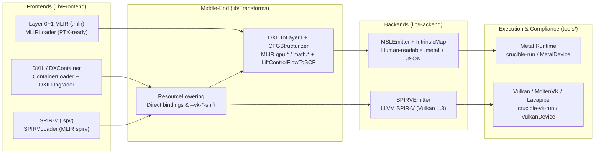

<div align="center">

# Crucible

**An open-source multi-frontend, multi-backend shader compiler for DXIL, SPIR-V, and Metal Shading Language.**

[](https://github.com/farzonl/crucible/actions/workflows/ci.yml)
[](https://github.com/farzonl/crucible/actions/workflows/compliance.yml)
[](https://github.com/farzonl/crucible/actions/workflows/macos-benchmark.yml)
[](https://farzonl.github.io/crucible/?track=dxil-to-metal)
[](https://farzonl.github.io/crucible/?track=dxil-to-spirv)
[](https://farzonl.github.io/crucible/?track=spirv-to-metal)
[](#building)
[](LICENSE)

[**Live Compliance Dashboard**](https://farzonl.github.io/crucible/) · [**DXIL → Metal Track**](https://farzonl.github.io/crucible/?track=dxil-to-metal) · [**DXIL → SPIR-V Track**](https://farzonl.github.io/crucible/?track=dxil-to-spirv) · [**SPIR-V → Metal Track**](https://farzonl.github.io/crucible/?track=spirv-to-metal) · [**Live Benchmark Dashboard**](https://farzonl.github.io/crucible/bench.html)

</div>

---

## Overview

**Crucible** (`cruciblec`) compiles shader binaries across modern GPU ecosystems using upstream **LLVM** and **MLIR**—no custom binary parsers, no closed-source `.air` bitcode hacks, and no heavyweight argument-buffer overhead.

- **Metal backend (`--target=msl`)**: Emits clean, human-readable **Metal Shading Language** with zero-overhead direct `[[buffer(n)]]` bindings and JSON reflection, compiled via Apple's native `xcrun metal` / `metallib` toolchain.
- **Vulkan SPIR-V backend (`--target=spirv`)**: Lowers DXIL directly to **Vulkan 1.3 SPIR-V** via LLVM's built-in SPIR-V backend (`spirv1.6-unknown-vulkan1.3-*`), supporting compute, VS/PS graphics, textures/samplers, bindless descriptor heaps, inline `RayQuery`, and DXC-compatible `--vk-*-shift` register shifts.
- **Multi-frontend ingestion**: Auto-detects and accepts **DXIL** (`.dxil` DXContainer or bare LLVM 3.7 bitcode), **SPIR-V** (`.spv`, lowered via MLIR's `spirv` dialect), and standalone **Layer 0+1 MLIR** (`.mlir`, PTX/compute-IR compatible `func` + `scf` + `llvm` + `gpu` + `math`).

### Supported Translation Paths

| Frontend | Backend | Status | Execution / CI Track |
| :--- | :--- | :--- | :--- |
| **DXIL** (`.dxil` / DXContainer) | **Metal MSL** (`--target=msl`) | Compute, VS/PS Graphics, Wave/Quad, Atomics, Bindless | macOS Apple Silicon (`dxil-to-metal`) |
| **DXIL** (`.dxil` / DXContainer) | **Vulkan SPIR-V** (`--target=spirv`) | Compute, VS/PS Graphics, Textures, Bindless, Inline RT | Linux Lavapipe & macOS MoltenVK (`dxil-to-spirv`) |
| **SPIR-V** (`.spv`) | **Metal MSL** (`--target=msl`) | Compute, VS/PS Graphics, Textures/Samplers, Typed Buffers, Wave/Subgroup | macOS Apple Silicon (`spirv-to-metal`) |
| **Layer 0+1 MLIR** (`.mlir`) | **Metal MSL** (`--target=msl`) | `addrspace(1)` pointer kernels, `gpu.*`, `math.*`, `scf.*` (PTX-ready) | FileCheck (`mlir_layer01_ptx_ready`) |

---

## Architecture



Wave votes, ballots, active/prefix bit counts, first-lane queries, and
multi-prefix operations depend on the currently active lanes. Their MLIR
operations retain conservative effects to prevent optimization from moving or
merging them across divergent control flow.

---

## Benchmarks & Compliance

### Apple Silicon Compute Benchmarks (`crucible` vs. `metal-shaderconverter`)

Both compilers translate identical `dxc` DXIL and dispatch through the same native runner (`crucible-run --bench-json`, GPU timestamps; median ms, lower is better):

| Workload | Crucible (ms) | `metal-shaderconverter` (ms) |
| :--- | ---: | ---: |
| **Streaming FMA** (memory-bound) | 1.59 | 1.59 |
| **Mandelbrot Loop** (ALU-bound) | 1.54 | **1.16** |
| **Groupshared Reduction** (barrier-bound) | **1.26** | 1.64 |
| **Wave Prefix Ops** (SIMD-bound) | 1.55 | 1.54 |

```mermaid
%%{init: {"themeVariables": {"xyChart": {"plotColorPalette": "#2563eb, #16a34a"}}}}%%
xychart-beta
    title "Apple Silicon Median GPU Dispatch Time — Lower is Better (ms)"
    x-axis ["Streaming FMA", "Mandelbrot", "Groupshared Reduce", "Wave Prefix"]
    y-axis "Median GPU Time (ms)" 0 --> 2.0
    bar [1.59, 1.54, 1.26, 1.55]
    bar [1.59, 1.16, 1.64, 1.54]
```



🟦 **Blue**: Crucible · 🟩 **Green**: `metal-shaderconverter`

> [!TIP]
> Track per-commit GPU timings on the [**Live Benchmark Dashboard**](https://farzonl.github.io/crucible/bench.html) and multi-backend [llvm/offload-test-suite](https://github.com/llvm/offload-test-suite) pass rates on the [**Live Compliance Dashboard**](https://farzonl.github.io/crucible/).
> Click a category or regime winner with recorded timings to select its scope; category scopes are populated from the benchmark history.

### Multi-Runtime `offload-test-suite` Integration

`tools/crucible-offload` builds upstream `offloader` and `api-query` against a unified multi-runtime device provider (`MetalDevice` + `VulkanDevice`). Crucible advertises DirectX and Vulkan facades with the `Crucible` driver tag, so tests are selected using the frontend contract being exercised:

- **macOS (`dxil-to-metal`)**: `check-crucible-offload-dx-to-metal` (`CRUCIBLE_OFFLOAD_RUNTIME=metal`, default on macOS) compiles DXIL → MSL and dispatches on Metal.
- **macOS (`spirv-to-metal`)**: `check-crucible-offload-vk-to-metal` (`lit -Dspirv_frontend=1 -Doffload_runtime=metal`) compiles HLSL via `dxc -spirv -fspv-target-env=vulkan1.3`, lowers SPIR-V → MLIR → MSL, and dispatches on Metal.
- **Native Vulkan drivers**: `check-crucible-offload-vk-molten` and `check-crucible-offload-vk-kosmickrisp` run the same SPIR-V tests directly on each advertised driver.
- **Linux Lavapipe / macOS MoltenVK / KosmicKrisp (`dxil-to-spirv`)**: `check-crucible-offload-dx-to-vk` (`lit -Doffload_runtime=vulkan` / `CRUCIBLE_OFFLOAD_RUNTIME=vulkan`, default on Linux) compiles DXIL → SPIR-V and dispatches on Vulkan.

---

## Building

### Crucible Vulkan CTS compiler dashboard

[Vulkan CTS dashboard](https://farzonl.github.io/crucible/vulkan-cts.html) adds a
zoomable directory treemap: area represents selected test count, color represents
strict pass rate, and clicking/scrolling drills down to an individual test.
Breadcrumbs, keyboard navigation, searchable/sortable results, and per-commit
history are available in light and dark modes.

The `vulkan-cts-macos` job measures **Crucible SPIR-V-to-MSL compilation and CTS
GPU execution**, not just whether shader translation succeeds. A CTS-only
MoltenVK build replaces each pipeline's shader source with Crucible's emitted
MSL. MoltenVK/SPIRV-Cross still supplies runtime interface metadata and workgroup
sizes, but its generated shader code is discarded. Compilation failures never
fall back to native MSL. Identical cases also run through the same driver with
the hook disabled, providing a separately labeled **native reference**, not a
guaranteed upper bound or Crucible score.

The initial baseline pins VK-GL-CTS `vulkan-cts-1.4.7.1` at
`0d18b347943e5e843529a05c95220e27fe30c538`. It deterministically selects at most
256 evenly spaced, lexicographically sorted cases from
`external/vulkancts/mustpass/main/vk-default/spirv-assembly.txt`, restricted to
`dEQP-VK.spirv_assembly.instruction.compute.*`. This is a bounded **sample**, not
the full must-pass suite; each track runs fraction 0/1 with a 900-second execution
budget. The initial adapter supports direct-bound, single buffers (including
push constants), remapping descriptor sets/bindings and the emitted entry name
to MoltenVK's actual Metal ABI. Graphics, descriptor arrays, textures/samplers,
specialization constants and auxiliary-buffer ABIs are not yet integrated.
Adapter rejection is visible, rather than being hidden by native fallback.

SPIR-V integer dot products include packed and unpacked `SDotAccSat`,
`SUDotAccSat`, and `UDotAccSat`, lowered to Metal saturating addition after
the dot product. Only the final accumulation saturates; intermediate dot-product
overflow remains undefined as specified by SPIR-V. Native CTS parity is tracked
case-by-case in [#144](https://github.com/farzonl/crucible/issues/144).

Byte-sized Metal buffer elements retain their one-byte storage stride, including
packed vectors and byte offsets; stores do not widen into adjacent elements.

Legacy single-member `Uniform` blocks marked `BufferBlock` remain storage
buffers, including fixed-size arrays; `Uniform` blocks marked `Block` remain cbuffers.
Storage array accesses retain declared strides and member offsets.
`OpInBoundsAccessChain` uses the same address calculation as `OpAccessChain`.

SPIR-V helpers are inlined before entry-point resource lowering. Scalar/vector
`OpCopyMemory` is expanded into typed loads and stores with separate source and
target memory operands. Volatile Metal buffer loads are materialized in source
order (including unused reads), and volatile scalar local accesses and buffer
stores use volatile-qualified pointers. Aggregate copies, volatile LLVM vector
accesses, and volatile buffer re-emission to SPIR-V remain explicitly unsupported.

MoltenVK 1.4.2 is pinned at `db66022459ffb663aa2b50f6b018bc2e124f5edf`;
its external dependencies and CTS dependencies are pinned by their sources.
Loader and Xcode versions, the compiler path, adapter hash and exact invocation
are recorded per run, along with the actual Vulkan physical device and runtime
configuration. Vulkan 1.4 is negotiated normally. Metal argument buffers are disabled in both
tracks to match the adapter's direct-binding ABI. Every case runs in a fresh process, with a separate
compiler attribution trace and raw QPA. Shader compilation is limited to 30
seconds; reaching the track budget terminates the entire process group.

Local macOS reproduction (Xcode, CMake, Ninja, Python 3.10+):

```bash
brew install ninja vulkan-loader
python3 -m pip install lxml
# First build Crucible using the normal build instructions below.
git clone https://github.com/KhronosGroup/MoltenVK .cts/mvk
git -C .cts/mvk checkout db66022459ffb663aa2b50f6b018bc2e124f5edf
python3 scripts/prepare_cts_moltenvk.py --source .cts/mvk
(cd .cts/mvk && ./fetchDependencies --macos && make macos)
git clone https://github.com/KhronosGroup/VK-GL-CTS .cts/src
git -C .cts/src checkout 0d18b347943e5e843529a05c95220e27fe30c538
python3 .cts/src/external/fetch_sources.py
cmake -S .cts/src -B .cts/build -G Ninja -DCMAKE_BUILD_TYPE=Release -DDEQP_TARGET=osx
cmake --build .cts/build --target deqp-vk --parallel 3
python3 scripts/record_vulkan_cts.py select \
  --source .cts/src/external/vulkancts/mustpass/main/vk-default/spirv-assembly.txt \
  --prefix dEQP-VK.spirv_assembly.instruction.compute. \
  --limit 256 --output cts-results/caselist.txt
export VK_ICD_FILENAMES="$PWD/.cts/mvk/Package/Release/MoltenVK/dynamic/dylib/macOS/MoltenVK_icd.json"
export VK_DRIVER_FILES="$VK_ICD_FILENAMES"
COMMON=(python3 scripts/record_vulkan_cts.py run \
  --binary .cts/build/external/vulkancts/modules/vulkan/deqp-vk \
  --archive .cts/build/external/vulkancts/modules/vulkan \
  --library "$(brew --prefix vulkan-loader)/lib/libvulkan.1.dylib" \
  --caselist cts-results/caselist.txt --timeout 900 \
  --sha "$(git rev-parse HEAD)" --run-url https://github.com/farzonl/crucible/actions \
  --cts-revision 0d18b347943e5e843529a05c95220e27fe30c538 \
  --runtime-version "MoltenVK@db660224;$(brew list --versions vulkan-loader);$(xcodebuild -version | tr '\n' ';')" \
  --baseline "vulkan-cts-1.4.7.1 spirv-assembly compute sample 256, fraction 0/1")
"${COMMON[@]}" --qpa cts-results/reference.qpa --metadata cts-results/reference-metadata.json
"${COMMON[@]}" --compiler build/tools/cruciblec/cruciblec \
  --qpa cts-results/results.qpa --metadata cts-results/metadata.json
python3 scripts/record_vulkan_cts.py record \
  --qpa cts-results/results.qpa --caselist cts-results/caselist.txt \
  --metadata cts-results/metadata.json --data-dir pages/data \
  --reference-qpa cts-results/reference.qpa \
  --reference-metadata cts-results/reference-metadata.json
```

`data/vulkan-cts/latest.json` contains run/commit/CTS/runtime metadata, status
counts, individual `tests` with compiler evidence and original CTS statuses,
`failures`, a recursively aggregated `tree`, and a separate `reference` dataset.
`history.json` keeps summary-only entries, replacing the same commit on rerun;
`badge.json` is a Crucible-only Shields endpoint. Only a CTS `Pass` with at least
one shader compilation, all attempted shaders successfully compiled, and no
adapter/metadata/compiler failures enters the numerator. Every
selected case enters the denominator: `NotSupported`, warnings, errors,
`Pending`, and `NotRun` are kept separate. `CompilerError`, `MetadataError`,
`AdapterUnsupported`, and `NotExercised` distinguish compiler rejection from
adapter limitations or tests that never compile a shader. A run with no observed
Crucible invocation cannot publish a compiler score. Interrupted records become
`InternalError`, missing selected cases become `NotRun`, and empty/malformed QPA
cannot publish a success score. Unselected CTS cases are never counted.
History charts do not connect different caselist hashes, CTS revisions, adapter
hashes, devices, runtime configurations, or runtime versions. Both existing Pages publishers preserve the CTS JSON dataset.
Build/history caches and raw QPA/caselist/metadata artifacts support reruns.

Validate the recorder with `python3 -m unittest discover -s scripts -p 'test_vulkan_cts.py'`.
For branch validation without publishing Pages, dispatch Compliance with
`cts_only=true`. This tracking infrastructure does not complete #7 or claim full
Vulkan conformance; remaining compiler and adapter gaps stay visible under #31.

Requirements: **CMake ≥ 3.24**, **Ninja**, **LLVM + MLIR ≥ 16** (with the SPIR-V target enabled for `--target=spirv`), **`dxc`**, **`lit`**, and optionally **`spirv-val`** / **Vulkan SDK** (or MoltenVK / Mesa Lavapipe) and **Xcode CLT** (on macOS).

```sh
cmake -S . -B build -G Ninja -DCMAKE_BUILD_TYPE=Release
ninja -C build
ninja -C build check-crucible                        # FileCheck + Metal/Vulkan GPU E2E tests
ninja -C build check-crucible-offload-dx-to-metal    # llvm/offload-test-suite (DXIL -> MSL -> Metal)
ninja -C build check-crucible-offload-dx-to-vk       # llvm/offload-test-suite (DXIL -> SPIR-V -> Vulkan)
ninja -C build check-crucible-offload-vk-to-metal    # llvm/offload-test-suite (SPIR-V -> MSL -> Metal)
ninja -C build check-crucible-offload-vk-kosmickrisp # Vulkan/SPIR-V on KosmicKrisp
ninja -C build check-crucible-offload-vk-molten      # Vulkan/SPIR-V on MoltenVK
```

Useful CMake flags: `-DLLVM_DIR=...`, `-DDXC_EXECUTABLE=...`, `-DLLVM_EXTERNAL_LIT=...`, `-DCRUCIBLE_OFFLOAD_SUITE_DIR=...`.

### Vulkan buffer layout and residency

Raw and structured GPU buffers are padded to complete 32-bit words, including
the final word of native 16-bit buffers. CPU readback retains the logical size.
Shaders querying raw-buffer sizes, sub-word structured-buffer dimensions, or
buffer residency may require an auxiliary StorageBuffer descriptor, identified
by `bufferInfoSpirvBinding` in each reflected binding. Each descriptor-array
element supplies two `uint32_t` values: logical byte size and mapped byte size.
For ordinary buffers, both values are the logical byte size.

The Vulkan offload provider supplies this metadata automatically. Reserved-buffer
loads use the same mapped-prefix model as the Metal provider: `TilesMapped`
64-KiB tiles are resident, and the remaining bytes read as zero. This is buffer
load emulation, not general Vulkan sparse-resource support.

---

## Usage & Tools

```sh
# DXIL -> Metal MSL + reflection + .metallib
cruciblec shader.dxil -o out.metal --reflect out.json --metallib out.metallib

# DXIL -> Vulkan 1.3 SPIR-V (binary or --spv-asm text)
cruciblec shader.dxil --target=spirv -o out.spv --reflect out.json
cruciblec shader.dxil --target=spirv --spv-asm --vk-u-shift=10 -o out.spvasm

# SPIR-V -> Metal MSL (or inspect converged Layer 1 MLIR with --dump-mlir)
cruciblec shader.spv -o out.metal --reflect out.json
cruciblec kernel.mlir -o out.metal --dump-mlir

# Run GPU E2E dispatches directly
crucible-run --lib out.metallib --entry main0 --threads 64,1,1 --groups 1,1,1 --buffer 0:f32:64:iota
crucible-vk-run --spv out.spv --reflect out.json --groups 1,1,1 --buffer 0:f32:64:iota
```

| Tool | Purpose |
| :--- | :--- |
| `tools/cruciblec` | Multi-frontend, multi-backend compiler CLI (`--target=msl\|spirv`, `--reflect`, `--metallib`, `--vk-*-shift`, `--stage-as-compute`, `--dump-mlir`). |
| `tools/crucible-run` | Native Metal compute runner and GPU-timestamp benchmark harness (`--bench-json`). |
| `tools/crucible-vk-run` | Vulkan / MoltenVK / Lavapipe compute runner for SPIR-V GPU E2E verification. |
| `tools/crucible-offload` | Multi-runtime `llvm/offload-test-suite` device provider (`MetalDevice` + `VulkanDevice` via `CRUCIBLE_OFFLOAD_RUNTIME`). |

---

## Built On & License

Crucible stands on **[LLVM + MLIR](https://llvm.org)**, **[DirectXShaderCompiler](https://github.com/microsoft/DirectXShaderCompiler)**, **[SPIRV-Tools](https://github.com/KhronosGroup/SPIRV-Tools)**, and patterns lifted from **[Nacelle](https://github.com/farzonl/Nacelle)** (DXIL loading, lit conventions, benchmark & compliance dashboards).

Licensed under **Apache-2.0 WITH LLVM-exception**.
